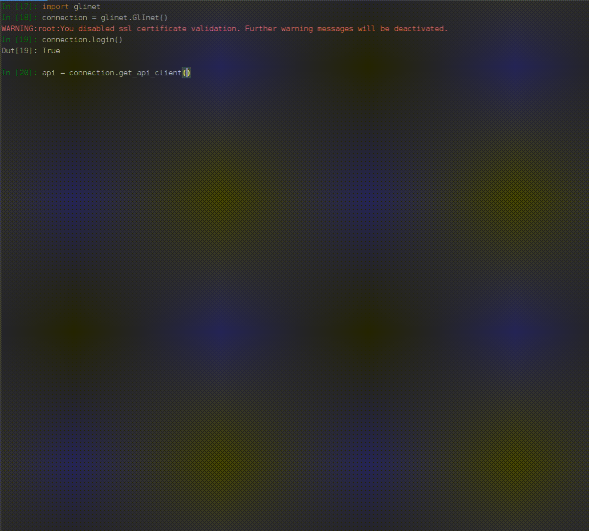

|GitHub Workflow Status (event)| |GitHub Pages| |PyPI - Python Version| |PyPI| |Code Cov|

python-glinet: Python 3 Client for GL.iNet Routers
==================================================

Introduction
------------

``python-glinet`` is a robust Python 3 library for interacting with GL.iNet router's LuCI API on firmware 4.x and later. It enables developers to programmatically manage and configure GL.iNet routers with features like dynamic API method generation, object-oriented response parsing, and automated session maintenance. Ideal for automation scripts and integrations, it supports interactive exploration via IPython.

Features
--------

- **Comprehensive API Coverage**: Full access to LuCI API endpoints for firmware 4.x+.
- **Dynamic Methods**: Auto-generates methods with docstrings from API documentation.
- **Intuitive Responses**: Converts JSON responses to objects for dot-notation access.
- **Session Handling**: Background thread for connection persistence; cached credentials.
- **Interactive Support**: Optimized for IPython with code completion and docstrings.

.. note::

   - Supports firmware 4.x+ only, following GL.iNet's JSON-RPC transition.
   - Uses archived API snapshot from `Internet Archive <https://web.archive.org/web/20230909030858/https://dev.gl-inet.com/router-4.x-api/>`__ .

Installation
------------

Via pip (recommended in a virtual environment):

.. code-block:: bash

   pip install python-glinet

From source for development:

.. code-block:: bash

   git clone https://github.com/tomtana/python-glinet.git
   cd python-glinet
   python3 -m venv venv
   source venv/bin/activate
   pip install -e .

See `Python's venv guide <https://docs.python.org/3/tutorial/venv.html>`__ for details on virtual environments.

Quick Start
-----------

The ``GlInet`` class manages authentication and API interactions. Customize defaults (e.g., IP, username) via constructor parameters. Refer to `class docs <https://tomtana.github.io/python-glinet/glinet.html>`__.

.. code-block:: python

   from pyglinet import GlInet
   glinet = GlInet().login()  # Instantiates and logs in

.. warning::

   Do not pass passwords in code; use persistence or prompts for security.

.. note::

   - Loads API description from cache or online.
   - ``login()`` handles credentials and starts session keeper.

API Usage
---------

Dynamic Client
''''''''''''''

In IPython, after login:

.. code-block:: python

   api_client = glinet.get_api_client()

- Structure: ``api_client.<group>.<method>``
- Naming: Hyphens replaced with underscores (e.g., ``wg_client``).
- Navigation: Use tab completion and ``?`` for docstrings.

Examples
~~~~~~~~

List groups:

.. code-block:: python

   api_client

Explore methods:

.. code-block:: python

   api_client.wg_client

View parameters:

.. code-block:: python

   api_client.wg_client.set_config

Docstring:

.. code-block:: python

   api_client.wg_client.set_config?

Call method:

.. code-block:: python

   api_client.wg_client.get_all_config_list()

Responses are objects for easy access.

Direct Requests
'''''''''''''''

.. code-block:: python

   glinet.request("call", ["adguardhome", "get_config"])

Equivalent to ``api_client.adguardhome.get_config()``, but returns full response.

Roadmap
-------

- [x] Dynamic docstrings
- [x] PyPI package
- [x] Tests and coverage
- [x] Windows compatibility
- [ ] Cli wrapper

Contributing
------------

Welcome contributions! Fork, branch, and PR on `GitHub <https://github.com/tomtana/python-glinet>`__. Test changes and follow roadmap.

For issues, use `GitHub Issues <https://github.com/tomtana/python-glinet/issues>`__.

License
-------

MIT License. See `LICENSE <https://github.com/tomtana/python-glinet/blob/main/LICENSE>`__.

.. |GitHub Workflow Status (event)| image:: https://img.shields.io/github/actions/workflow/status/tomtana/python-glinet/python-tests.yml?branch=main&label=tests
   :target: https://github.com/tomtana/python-glinet/actions/workflows/python-tests.yml
.. |PyPI - Python Version| image:: https://img.shields.io/pypi/pyversions/python-glinet
   :target: https://pypi.org/project/python-glinet
.. |PyPI| image:: https://img.shields.io/pypi/v/python-glinet
   :target: https://pypi.org/project/python-glinet
.. |image3| image:: /resources/python_glinet_demo.gif
.. |GitHub Pages| image:: https://img.shields.io/github/actions/workflow/status/tomtana/python-glinet/build_deploy_pages.yml?branch=main&label=docs
   :alt: GitHub Workflow Status
   :target: https://tomtana.github.io/python-glinet/
.. |Code Cov| image:: https://codecov.io/gh/tomtana/python-glinet/branch/main/graph/badge.svg?token=976L8ESH8K
 :target: https://codecov.io/gh/tomtana/python-glinet